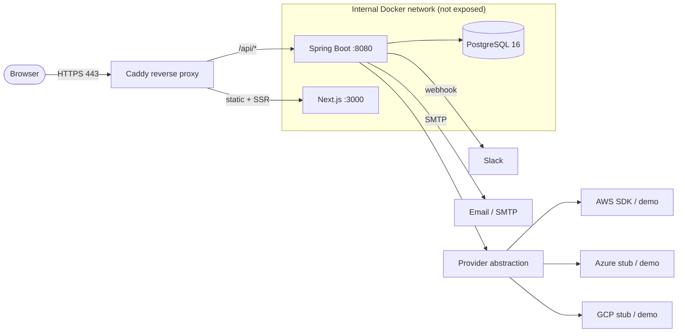

# CloudManagerPro

[](LICENSE)
[](#)
[](docs/DEPLOYMENT_VM.md)
[](docker/)
[](#features)

**CloudManagerPro** is a Docker-first, self-hostable **multi-cloud FinOps platform**. Connect your
AWS, Azure, and GCP accounts to get a single, unified view of every cloud resource you own, surface
wasted spend (idle compute, orphaned volumes, unused IPs, stale snapshots, missing tags), and get
rightsizing and cost-saving recommendations. Act on it all from a unified **Optimize** hub and the
Resources drawer — start/stop/resize/tag/terminate instances individually or in **bulk**, and apply
idle/rightsizing fixes in one click — safely, with always-on **dry-run** protection. Deploy the whole
stack on a single Linux VM with one command and automatic HTTPS.

> Backend: **Spring Boot 3 + PostgreSQL** with JWT auth, tenant isolation, encrypted credentials, and
> a pluggable provider abstraction (with realistic demo data so the app is fully usable with zero cloud
> credentials). Frontend: a polished, **monochrome (black & white) Next.js 14** dashboard.

---

## Table of contents

- [Features](#features)
- [Tech stack](#tech-stack)
- [Architecture](#architecture)
- [Screenshots](#screenshots)
- [Quick start](#quick-start)
- [Local development](#local-development)
- [Docker production deployment](#docker-production-deployment)
- [Environment variables](#environment-variables)
- [Security](#security)
- [Roadmap](#roadmap)
- [Documentation](#documentation)
- [Contributing](#contributing)
- [License](#license)

---

## Features

CloudManagerPro ships with the following capabilities out of the box:

1. **Email signup & login** — self-serve accounts secured with JWT (HS256) and BCrypt password hashing.
2. **Unified dashboard** — overview with metric cards, cost trend, provider breakdown, and recent sync/alert activity.
3. **Connect AWS accounts** — via IAM access keys or (preferred) an IAM Role ARN + External ID using STS AssumeRole.
4. **Connect Azure subscriptions** — production-shaped integration (demo-backed in the MVP).
5. **Connect GCP projects** — production-shaped integration (demo-backed in the MVP).
6. **Resource sync** — automatic background sync every 10 minutes plus one-click on-demand sync, tracked as sync jobs.
7. **Unified inventory** — one searchable, filterable resource explorer across all providers, regions, and resource types.
8. **Idle resource detection** — flags underutilized compute based on CloudWatch-style metrics.
9. **Orphaned resource detection** — finds resources with no owner or attachment.
10. **Unattached disk detection** — surfaces EBS volumes not attached to any instance.
11. **Unused IP detection** — surfaces Elastic IPs that aren't associated with anything (and still cost money).
12. **Old snapshot detection** — flags stale snapshots beyond your retention window.
13. **Missing tag detection** — finds resources that lack your required tags.
14. **Cost-waste detection** — quantifies the dollars tied up in wasteful resources.
15. **Cost insights** — summary, trend over time, and breakdowns by provider, service, and region, plus savings opportunities.
16. **Tag compliance** — policy scoring with per-resource offender lists.
17. **Rightsizing recommendations** — instance downsizing/modernization suggestions with estimated savings.
18. **Unified Optimize hub** — Cleanup, Idle, and Rightsizing merged into one tabbed page (`/dashboard/optimize`) with an Overview of top savings opportunities and one-click **Apply / Snooze / Dismiss**; the old `/dashboard/{cleanup,idle,rightsizing}` URLs redirect to the matching tab.
19. **Resource actions** — Start / Stop / Restart / Resize / Edit tags / Terminate plus storage cleanup, from the Resources detail drawer and a multi-select **bulk action bar**; every action is dry-run → confirm → execute and labeled real vs. simulated (`providerMode`) per resource.
20. **Snooze & dismiss recommendations** — hide an item for 7 / 30 / custom days (it auto-returns) or dismiss it permanently, across idle/rightsizing/cleanup.
21. **Slack & email alerts** — configurable digests with one-click "send test" buttons for both channels.
22. **Safe actions with dry-run** — every action is dry-run first; real cloud mutations are disabled by default (`ENABLE_REAL_CLOUD_ACTIONS=false`) and gated again per-account (demo/Azure/GCP simulate); destructive actions require type-to-confirm; everything is audited.
23. **Activity & audit logs** — full action, sync, and alert history.
24. **Self-hosted via Docker Compose** — the entire stack runs on one Linux VM with automatic HTTPS via Caddy.

> **Demo mode is on by default** (`ENABLE_DEMO_DATA=true`), so you can explore the whole product with
> realistic synthetic resources, costs, and metrics before connecting a single real cloud account.

---

## Tech stack

### Frontend
- **Next.js 14** (App Router) + **React 18** + **TypeScript**
- **Tailwind CSS** + **shadcn/ui** components
- **TanStack React Query** for data fetching/caching
- **Recharts** for charts
- **next-themes** for dark/light theming (dark by default)
- **lucide-react** icons
- Standalone Docker build (`output: 'standalone'`)

### Backend
- **Spring Boot 3** on **Java 17**
- **Spring Security 6** with stateless **JWT (HS256)** auth and **BCrypt** password hashing
- **Spring Data JPA** / Hibernate 6
- **PostgreSQL** with **Flyway** migrations
- Scheduled jobs for sync, analysis, cost ingestion, and alert digests
- Maven (with Maven Wrapper)

### Infrastructure
- **Docker** & **Docker Compose**
- **Caddy** reverse proxy with automatic HTTPS (Let's Encrypt)
- **PostgreSQL 16**

> **Monochrome UI:** the dashboard uses a sharp, minimal **black / white / gray** aesthetic
> (resend.com-style) in **both light and dark modes** — thin borders, high contrast, grayscale charts,
> and **red reserved for destructive/error states only**. It stays dense and keyboard-friendly: compact
> readable tables, a global command palette (`Ctrl`/`Cmd`+`K`), and right-side detail drawers.

> **Deployment model:** CloudManagerPro is **Docker-first** and designed to be **self-hosted on a single
> Linux VM**. Caddy terminates TLS on ports 80/443; the frontend, backend, and PostgreSQL run on an
> internal Docker network and are never exposed directly to the internet.

---

## Architecture



- The browser only ever talks to **Caddy** over HTTPS.
- Caddy proxies `/api/*` to the **Spring Boot** backend and everything else to **Next.js**.
- The backend owns all cloud access through a **provider abstraction** and persists state in **PostgreSQL**.
- Backend, frontend, and database live on an internal Docker network; **only Caddy is published**.

See [docs/ARCHITECTURE.md](docs/ARCHITECTURE.md) for the deep dive (provider abstraction, sync engine,
cleanup engine, alert engine, cost engine, and the tenant isolation model).

---

## Screenshots

> _Screenshots coming soon._ Drop images into `docs/screenshots/` and reference them here.

| Dashboard overview | Resource explorer |
| --- | --- |
| _`docs/screenshots/dashboard.png`_ | _`docs/screenshots/resources.png`_ |

| Cost explorer | Cleanup (dry-run) |
| --- | --- |
| _`docs/screenshots/cost-explorer.png`_ | _`docs/screenshots/cleanup.png`_ |

---

## Quick start

The fastest way to see CloudManagerPro is the production Docker stack in demo mode:

```bash
# 1. Clone
git clone https://github.com/your-org/cloudmanagerpro.git
cd cloudmanagerpro

# 2. Configure environment
cp docker/.env.production.example docker/.env.production
# edit docker/.env.production: set APP_DOMAIN and generate strong secrets
#   openssl rand -base64 48   # for JWT_SECRET and ENCRYPTION_SECRET

# 3. Launch the whole stack (Caddy + frontend + backend + Postgres)
cd docker && docker compose --env-file .env.production -f docker-compose.prod.yml up -d --build
```

Then open `https://<APP_DOMAIN>`, create an account, and explore with demo data. For a complete,
beginner-friendly VM walkthrough (DNS, firewall, backups, updates), see
[docs/DEPLOYMENT_VM.md](docs/DEPLOYMENT_VM.md).

---

## Local development

Run the database in Docker and the app natively for fast iteration. These are the three commands:

```bash
# 1. Start Postgres (+ pgAdmin) for local dev
cd docker && docker compose -f docker-compose.dev.yml up -d

# 2. Start the backend (CORS allows http://localhost:3000)
cd backend && ./mvnw spring-boot:run -Dspring-boot.run.profiles=local

# 3. Start the frontend (point it at the local backend)
cd frontend && npm install && npm run dev   # NEXT_PUBLIC_API_URL=http://localhost:8080/api
```

- Frontend dev server: `http://localhost:3000`
- Backend API: `http://localhost:8080/api` (health at `http://localhost:8080/api/health`)

See [docs/CONTRIBUTING.md](docs/CONTRIBUTING.md) for full setup, branch strategy, and conventions.

---

## Docker production deployment

The entire stack is defined in `docker/docker-compose.prod.yml` (Caddy, frontend, backend, PostgreSQL):

```bash
cd docker && docker compose --env-file .env.production -f docker-compose.prod.yml up -d --build
```

This builds and starts all services with `restart: unless-stopped`, healthchecks, an internal network,
and automatic HTTPS via Caddy for your `APP_DOMAIN`. Flyway runs the database migrations automatically
on backend startup, and data persists in a named PostgreSQL volume across restarts.

Helper scripts (described in [docs/DEPLOYMENT_VM.md](docs/DEPLOYMENT_VM.md)) wrap common operations:

| Script | Purpose |
| --- | --- |
| `scripts/deploy-vm.sh` | First-time deploy / bring the stack up |
| `scripts/update-vm.sh` | Pull latest code and rebuild/restart |
| `scripts/backup-db.sh` | Back up the PostgreSQL database |
| `scripts/restore-db.sh` | Restore the database from a backup |
| `scripts/healthcheck.sh` | Check that all services are healthy |

---

## Environment variables

Production configuration lives in `docker/.env.production` (copy it from
`docker/.env.production.example` and never commit the real file). Key variables:

| Variable | Required | Description | Example |
| --- | --- | --- | --- |
| `APP_DOMAIN` | yes | Public domain Caddy serves the app on and obtains a TLS certificate for. | `cloudmanager.example.com` |
| `POSTGRES_USER` | yes | PostgreSQL username created in the container. | `cloudmanager` |
| `POSTGRES_PASSWORD` | yes | PostgreSQL password. | _(strong random)_ |
| `POSTGRES_DB` | yes | PostgreSQL database name. | `cloudmanagerpro` |
| `DATABASE_URL` | yes | JDBC URL the backend/Flyway use. | `jdbc:postgresql://postgres:5432/cloudmanagerpro` |
| `DATABASE_USERNAME` | yes | DB username the backend connects with (matches `POSTGRES_USER`). | `cloudmanager` |
| `DATABASE_PASSWORD` | yes | DB password the backend connects with (matches `POSTGRES_PASSWORD`). | _(strong random)_ |
| `JWT_SECRET` | yes | Secret used to sign/verify JWTs (HS256). Use a long random value. | `openssl rand -base64 48` |
| `JWT_EXPIRATION_MS` | no | Access token lifetime in milliseconds. | `86400000` |
| `ENCRYPTION_SECRET` | yes | Key material for AES-256-GCM encryption of cloud credentials at rest. | `openssl rand -base64 48` |
| `FRONTEND_URL` | yes | Public URL of the frontend (used for links and CORS). | `https://cloudmanager.example.com` |
| `BACKEND_URL` | yes | Internal URL of the backend service. | `http://backend:8080` |
| `NEXT_PUBLIC_API_URL` | yes | API base path the browser calls (proxied by Caddy). | `/api` |
| `SMTP_HOST` | no | SMTP server host for email alerts (alerts no-op gracefully if unset). | `smtp.example.com` |
| `SMTP_PORT` | no | SMTP server port. | `587` |
| `SMTP_USERNAME` | no | SMTP username. | `alerts@example.com` |
| `SMTP_PASSWORD` | no | SMTP password. | _(secret)_ |
| `SMTP_FROM` | no | From address for outbound emails. | `alerts@cloudmanager.example.com` |
| `ENABLE_DEMO_DATA` | no | Use realistic synthetic data instead of real cloud calls. | `true` |
| `ENABLE_REAL_CLOUD_ACTIONS` | no | Allow real destructive cloud actions (otherwise dry-run only). | `false` |
| `AWS_DEFAULT_REGION` | no | Default AWS region for the AWS SDK. | `us-east-1` |

> The repository's root `.env.example` is a high-level pointer only; the file actually loaded in
> production is `docker/.env.production`. See [docs/SECURITY.md](docs/SECURITY.md) for secret-handling
> rules. **Never commit real secrets — only `*.example` templates are tracked.**

---

## Security

CloudManagerPro is built to safely hold cloud credentials and act on real infrastructure:

- **Encrypted credentials at rest** — cloud secrets are encrypted with **AES-256-GCM** (keyed by
  `ENCRYPTION_SECRET`) and are **never returned to the frontend** (always masked in responses).
- **JWT auth** — stateless HS256 tokens; passwords hashed with BCrypt; only signup/login/health are public.
- **Tenant isolation** — every query is scoped to the authenticated user; no cross-tenant data access.
- **Cleanup safety** — dry-run is always available, and real destructive actions are **disabled by
  default** (`ENABLE_REAL_CLOUD_ACTIONS=false`). Every action is written to an audit log.
- **Least-privilege IAM** — connect clouds with read-only + minimal cleanup permissions, preferably via
  an IAM **Role ARN + External ID** rather than static keys.

Read the full model, including a concrete least-privilege AWS IAM policy, in
[docs/SECURITY.md](docs/SECURITY.md).

---

## Roadmap

**Available now (MVP):** auth + tenant isolation, AWS (real-ish + demo fallback), Azure/GCP demo stubs,
unified inventory, waste detection, cost insights, tag compliance, rightsizing, a unified **Optimize**
hub, **resource actions** (start/stop/resize/tag/terminate + bulk) with one-click Apply and
snooze/dismiss, Slack/email alerts, safe dry-run-first actions, audit logs, a **monochrome** UI, and
one-command Docker self-hosting.

**Planned next:** full Azure & GCP implementations, Kubernetes cost optimization, a policy engine,
AI-powered recommendations, a hosted SaaS option, team management / enterprise RBAC, and billing
(Stripe) as a commercial add-on.

See [docs/ROADMAP.md](docs/ROADMAP.md) for details.

---

## Documentation

| Doc | What's inside |
| --- | --- |
| [docs/ARCHITECTURE.md](docs/ARCHITECTURE.md) | System architecture, provider abstraction, sync/cleanup/alert/cost engines, tenant isolation |
| [docs/API.md](docs/API.md) | Every REST endpoint with auth, request/response examples, and the error format |
| [docs/DEPLOYMENT_VM.md](docs/DEPLOYMENT_VM.md) | Beginner-friendly Linux VM deployment (DNS, Docker, scripts, HTTPS, firewall) |
| [docs/SECURITY.md](docs/SECURITY.md) | Credential encryption, JWT, tenant isolation, cleanup safety, IAM best practices |
| [docs/ROADMAP.md](docs/ROADMAP.md) | Current MVP and future direction |
| [docs/CONTRIBUTING.md](docs/CONTRIBUTING.md) | Local setup, branch strategy, PR rules, coding conventions |

---

## Contributing

Contributions are welcome! Please read [docs/CONTRIBUTING.md](docs/CONTRIBUTING.md) for local setup,
branch strategy, pull-request rules, and coding conventions before opening a PR.

---

## License

CloudManagerPro is licensed under the **Apache License 2.0**. See [LICENSE](LICENSE) for the full text.
