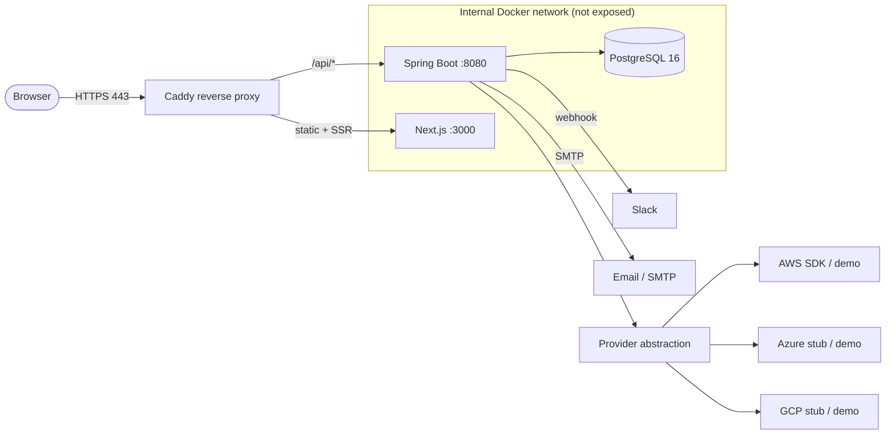
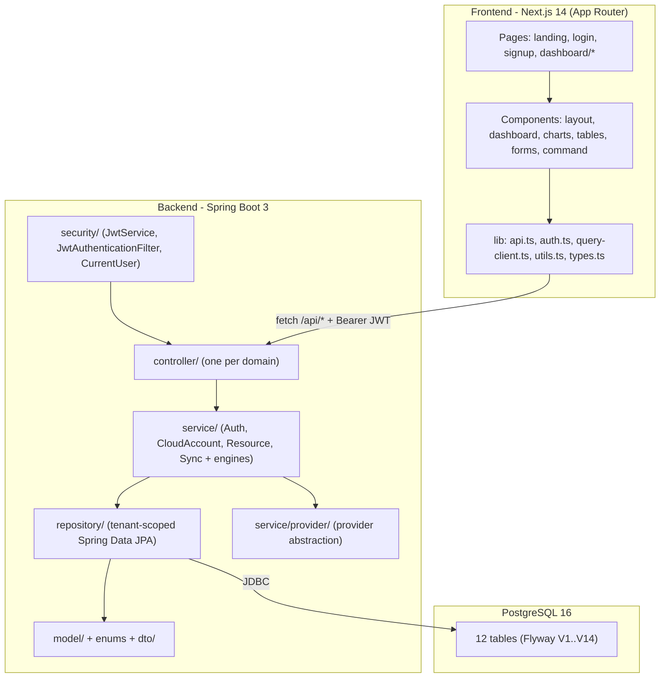
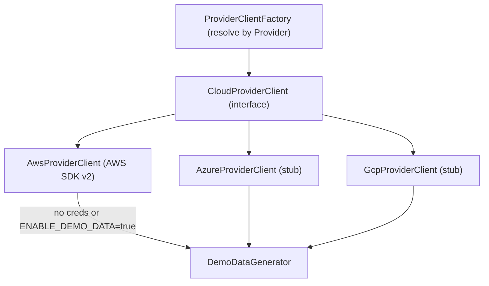
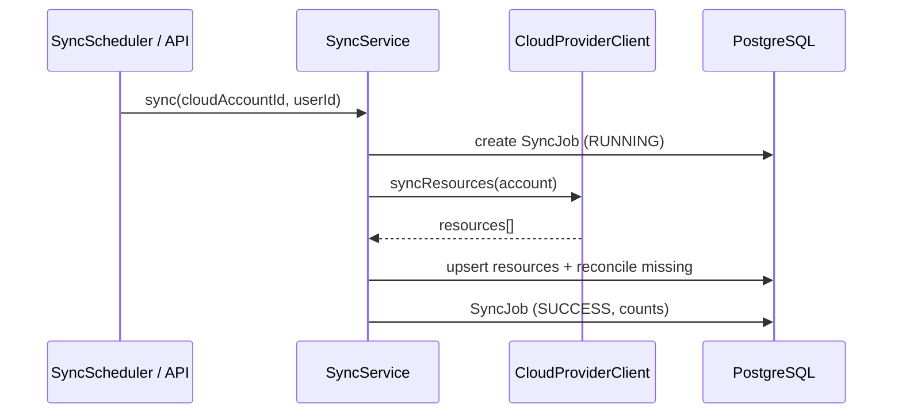
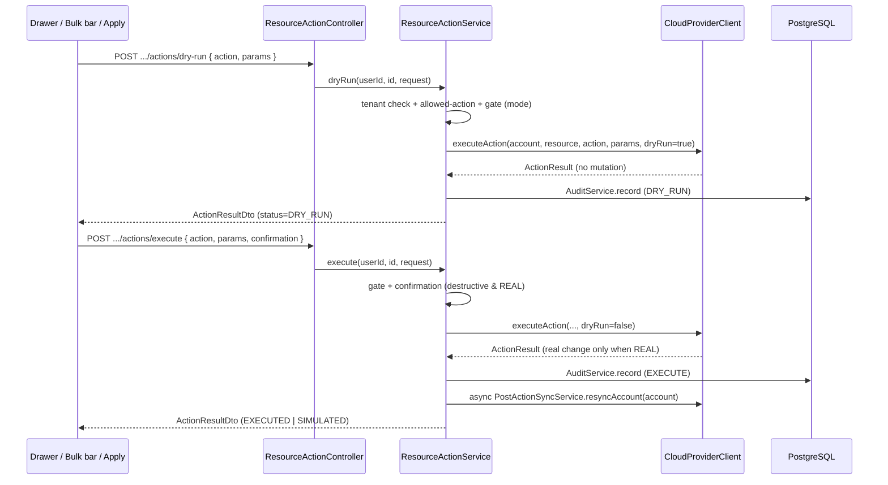
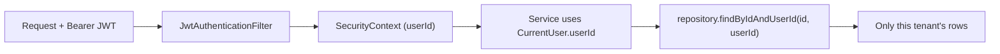

# Architecture

This document describes how **CloudManagerPro** is structured: the high-level system, the
frontend/backend/database layers, the cloud **provider abstraction**, the background **engines**
(sync, cleanup, alerts, cost), and the **tenant isolation** model that keeps every user's data
private.

> CloudManagerPro is a Docker-first, self-hostable multi-cloud FinOps platform: a Spring Boot 3 +
> PostgreSQL backend with JWT auth and tenant isolation, a provider abstraction with a demo fallback,
> and a Linear-inspired Next.js 14 dashboard, all deployable on a single Linux VM behind Caddy.

---

## 1. System overview

- **Caddy** is the only publicly exposed service (ports 80/443). It terminates TLS, adds security
  headers, and reverse-proxies `/api/*` to the backend and everything else to the frontend.
- **Next.js** renders the dashboard and talks to the backend exclusively through `/api` (same origin).
- **Spring Boot** is the single source of truth: it authenticates users, enforces tenant isolation,
  talks to clouds via the provider abstraction, runs scheduled jobs, and persists everything to
  PostgreSQL.
- **PostgreSQL** stores users, cloud accounts (with encrypted credentials), resources, and all
  derived analysis (cleanup/idle/cost/tag/rightsizing) plus logs.

---

## 2. Frontend / backend / database layers

### Frontend (`frontend/`)
- **App Router** structure: public `/`, `/login`, `/signup`, and a guarded `/dashboard/*` area with a
  shared layout (compact sidebar + top command bar + global command palette).
- `lib/api.ts` is a thin fetch wrapper that injects `Authorization: Bearer <token>` and uses
  `NEXT_PUBLIC_API_URL` as the base.
- `lib/auth.ts` persists the token; the dashboard layout is a client-side **auth guard** that redirects
  to `/login` when there is no token or `GET /api/auth/me` fails.
- **React Query** owns server state (caching, refetch, mutations); **Recharts** renders charts;
  **next-themes** drives dark/light mode (dark default).

### Backend (`backend/`, base package `com.cloudmanagerpro`)
- `config/` — `SecurityConfig`, `CorsConfig`, `JpaAuditingConfig`, `SchedulingConfig`, `OpenApiConfig`,
  `AppProperties` (binds feature flags + secrets).
- `security/` — `JwtService`, `JwtAuthenticationFilter`, `CustomUserDetailsService`, `SecurityUser`,
  and a `CurrentUser` helper that exposes the authenticated `userId`.
- `model/` + enums (`Provider`, `ResourceType`, `WasteState`, `Severity`, `SyncStatus`, `ActionType`,
  `AlertType`, …) and `dto/` request/response records (secrets always masked).
- `repository/` — Spring Data JPA repositories, **all tenant-scoped** (e.g. `findByIdAndUserId`).
- `service/` — `AuthService`, `CloudAccountService`, `ResourceService`, `SyncService`, plus engine
  sub-packages: `provider/`, `cleanup/`, `cost/`, `idle/`, `tags/`, `rightsizing/`, `alerts/`,
  `metrics/`, `audit/`.
- `scheduler/` — `SyncScheduler`, `AnalysisScheduler`, `CostIngestionScheduler`, `AlertScheduler`.
- `util/` — `EncryptionService` (AES-256-GCM) + a JPA `AttributeConverter` for encrypted fields, plus
  `JsonUtils`.
- `exception/` — `GlobalExceptionHandler` + typed exceptions producing uniform JSON errors with no
  secret/stack-trace leakage.
- `controller/` — one controller per domain (see [API.md](API.md)).

### Database (PostgreSQL 16)
- UUID primary keys; `jsonb` for tags/metadata/lists (Hibernate 6 `@JdbcTypeCode(SqlTypes.JSON)`);
  `timestamptz` timestamps; `numeric` for money.
- Every tenant-owned table has a `user_id` column **and an index on it**.
- Schema is created and versioned by **Flyway** migrations in
  `backend/src/main/resources/db/migration/`, applied automatically on startup:

| Version | Migration | Entity / purpose |
| --- | --- | --- |
| V1 | `V1__users.sql` | `users` |
| V2 | `V2__cloud_accounts.sql` | `cloud_accounts` (encrypted credentials) |
| V3 | `V3__cloud_resources.sql` | `cloud_resources` (unified inventory) |
| V4 | `V4__sync_jobs.sql` | `sync_jobs` |
| V5 | `V5__cleanup_candidates.sql` | `cleanup_candidates` |
| V6 | `V6__idle_candidates.sql` | `idle_candidates` |
| V7 | `V7__cost_daily.sql` | `cost_daily` |
| V8 | `V8__tag_compliance_results.sql` | `tag_compliance_results` |
| V9 | `V9__rightsizing_recommendations.sql` | `rightsizing_recommendations` |
| V10 | `V10__alert_settings.sql` | `alert_settings` |
| V11 | `V11__alert_logs.sql` | `alert_logs` |
| V12 | `V12__action_logs.sql` | `action_logs` |
| V13 | `V13__indexes_fks.sql` | indexes + foreign keys |
| V14 | `V14__recommendation_snooze.sql` | snooze/dismiss fields (`status`/`snoozed_until`) on idle, rightsizing & cleanup |

---

## 3. Provider abstraction

All cloud access goes through a single interface so the rest of the app never depends on a specific
cloud SDK. This is also what makes **demo mode** possible: a synthetic generator implements the same
contract as the real clients.

### `CloudProviderClient` interface
Defines the operations every provider must support:

- `testConnection(account)` — validate credentials / role.
- `syncResources(account)` — list resources (instances, volumes, IPs, snapshots, tags).
- `fetchCostData(account)` — pull cost/usage data.
- `fetchMetrics(account, resource)` — pull utilization metrics.
- `actionMode(account)` — report whether actions for this account run for `REAL` or are `SIMULATED`
  (the two-layer safety gate: real only when `ENABLE_REAL_CLOUD_ACTIONS=true` **and** the account has
  real credentials and demo mode is off).
- `executeAction(account, resource, action, params, dryRun)` — perform (or simulate) a resource action
  (`START`/`STOP`/`RESTART`/`RESIZE`/`ADD_TAGS`/`TERMINATE`/`DELETE_VOLUME`/`RELEASE_EIP`/
  `DELETE_SNAPSHOT`). `params` carries `instanceType` (resize) or `tags` (tagging).

### `ProviderClientFactory`
Resolves the correct client implementation from a `Provider` enum value (`AWS`, `AZURE`, `GCP`).

### `AwsProviderClient`
Uses **AWS SDK v2** for real data when credentials (or an assumed role) are present **and**
`ENABLE_DEMO_DATA=false`:
- EC2 instances, EBS volumes, Elastic IPs, snapshots, and tags
- CloudWatch metrics for utilization
- Cost Explorer for spend
- **STS AssumeRole** when connecting via Role ARN + External ID

If credentials are missing or demo mode is on, it falls back to the `DemoDataGenerator`.

### `AzureProviderClient` / `GcpProviderClient`
Production-shaped **stubs** that currently return demo data, so the UI is fully functional for all three
providers in the MVP. They implement the same interface, so swapping in real SDK calls later is a
localized change.

### `DemoDataGenerator`
Produces realistic synthetic resources, costs, and metrics so the entire product is usable with **zero
cloud credentials**. Demo mode is the default (`ENABLE_DEMO_DATA=true`).

---

## 4. Sync engine

Keeps the unified inventory current.

- **`SyncService` + `SyncJob`**: each sync run is recorded as a `SyncJob` (status `PENDING` →
  `RUNNING` → `SUCCESS`/`FAILED`, with counts and error messages).
- **Upsert + reconcile**: resources returned by the provider are upserted into `cloud_resources`;
  resources that disappear are reconciled (marked terminated/removed) so the inventory reflects reality.
- **`SyncScheduler`** runs every **10 minutes** for all connected accounts; users can also trigger an
  on-demand sync per account (`POST /api/cloud-accounts/{id}/sync` or `POST /api/sync/{cloudAccountId}`).
- All work is **tenant-scoped** — a sync only ever touches the requesting user's accounts and resources.

---

## 5. Cleanup engine

Finds wasteful resources and acts on them **safely**.

- **Detection** (`POST /api/cleanup/analyze`) scans the inventory and writes `cleanup_candidates`
  (e.g. unattached volumes, unused IPs, old snapshots, idle instances), each with an estimated monthly
  saving, a `WasteState`, and a recommended `ActionType`.
- **Dry-run first**: `POST /api/cleanup/{id}/dry-run` always simulates the action and reports what
  *would* happen — it never mutates cloud state.
- **Gated execution**: `POST /api/cleanup/{id}/execute` performs the real action **only** when
  `ENABLE_REAL_CLOUD_ACTIONS=true`. When the flag is off (the default), execution is simulated and
  logged exactly like a dry-run.
- **Ignore**: `POST /api/cleanup/{id}/ignore` dismisses a candidate.
- **Auditing**: every dry-run and execute writes an `ActionLog` row (who, what, when, dry-run vs real,
  result), surfaced under `GET /api/logs/actions`.

> See [SECURITY.md](SECURITY.md) for the full cleanup safety model.

---

## 6. Resource action engine

A single, safety-gated path executes **every** resource mutation — the Resources detail drawer, the
multi-select bulk bar, and the one-click **Apply** on idle/rightsizing recommendations all funnel
through it, so there is never a second mutation path.

- **`ResourceActionService`** is the one entry point. It validates tenant ownership, computes the
  **type/state-aware allowed actions** (e.g. a running EC2 → Stop/Restart/Resize/Edit tags/Terminate;
  a stopped one → Start/Resize/Edit tags/Terminate; an unattached volume → Delete volume), enforces the
  safety gate, audits the attempt, and triggers a re-sync. It always delegates the actual mutation to
  `CloudProviderClient.executeAction`.
- **`ResourceActionController`** exposes `GET /api/resources/{id}/actions`, the per-resource
  `dry-run`/`execute`, and the `POST /api/actions/bulk/{dry-run,execute}` endpoints.
- **Recommendation applies** reuse the same service: `RightsizingService.apply` maps a recommendation to
  a `RESIZE` (defaulting to `recommendedType`), and `IdleService.apply` maps an idle candidate to `STOP`
  (or `TERMINATE` for already-stopped compute, and the matching cleanup action for disks/IPs/snapshots).
- **Snooze / dismiss** (`RecommendationService` behind `POST /api/recommendations/{type}/{id}/{snooze,
  dismiss}`) sets `status`/`snoozed_until` (Flyway **V14**) so idle/rightsizing/cleanup items can be
  hidden until a date or permanently dismissed; analyses preserve those user decisions.

### Two-layer safety gate

`actionMode(account)` returns `REAL` **only** when `ENABLE_REAL_CLOUD_ACTIONS=true` **and** the account
has real credentials with demo mode off; otherwise `SIMULATED`. Dry-run is always allowed. Destructive
actions (terminate/delete/release) additionally require a matching `confirmation` in `REAL` mode. The
uniform `ActionResultDto` (`success`, `executed`, `dryRun`, `simulated`, `providerMode`, `status`, …)
lets the UI label simulated vs. real outcomes precisely.

### Action flow

After a real successful execute, an **async re-sync** of the affected account refreshes the inventory so
the drawer reflects the new state within seconds.

---

## 7. Alert engine

Notifies users about waste and savings opportunities.

- **`AlertSettings`** (per user) configure channels (Slack webhook, email) and what to be notified
  about; managed via `GET/PUT /api/settings/alerts`.
- **Senders**: a Slack sender (incoming webhook) and an email sender (SMTP). Email **no-ops gracefully**
  (logs only) when SMTP is not configured.
- **Test endpoints**: `POST /api/alerts/test-slack` and `POST /api/alerts/test-email` send a sample
  message so users can verify configuration.
- **`AlertScheduler`** sends a periodic (daily) digest; every send is recorded as an `AlertLog`
  (`GET /api/logs/alerts`).

---

## 8. Cost engine

Turns raw spend into insight.

- **`CostIngestionScheduler`** ingests daily cost data (from Cost Explorer or the demo generator) into
  the `cost_daily` table.
- **Aggregations** are exposed under `/api/cost/*`: `summary`, `trend`, `by-provider`, `by-service`,
  `by-region`, and `savings-opportunities`.
- **Rightsizing** (`/api/rightsizing`) and **idle** (`/api/idle`) analyses combine cost with metrics to
  recommend downsizing or removal, each with estimated savings.

---

## 9. Tenant isolation model

Every piece of business data belongs to exactly one user (tenant), and isolation is enforced
**server-side on every request** — never relying on the client.

- **Identity**: `JwtAuthenticationFilter` validates the Bearer token and populates the Spring
  `SecurityContext`; the `CurrentUser` helper exposes the authenticated `userId`.
- **Data ownership**: every tenant-owned table has a `user_id` column (indexed).
- **Scoped queries**: repositories expose **only** tenant-scoped finders (e.g. `findByIdAndUserId`,
  `findAllByUserId`). Services always pass the current `userId`, so a user can never read or mutate
  another tenant's account, resource, candidate, or log — even by guessing IDs (a mismatched
  `id`/`userId` returns "not found", never another tenant's row).
- **Secret confidentiality**: cloud credentials are encrypted at rest and masked in all responses, so
  isolation holds even at the DTO layer.

---

## Related docs

- [API.md](API.md) — all endpoints, auth, and examples
- [SECURITY.md](SECURITY.md) — encryption, JWT, cleanup safety, IAM
- [DEPLOYMENT_VM.md](DEPLOYMENT_VM.md) — running the stack on a Linux VM
- [ROADMAP.md](ROADMAP.md) — what's next
