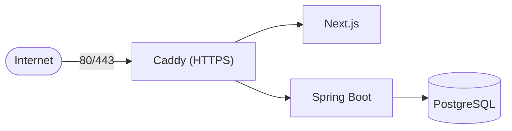

# Deploying CloudManagerPro on a Linux VM

This is a beginner-friendly, step-by-step guide to running **CloudManagerPro** on a single Linux VM
(Ubuntu/Debian assumed). When you're done you'll have the full stack — Caddy, frontend, backend, and
PostgreSQL — running in Docker with **automatic HTTPS**.

**What you need:**
- A Linux VM with a public IP (1 vCPU / 2 GB RAM works for demo; 2 vCPU / 4 GB recommended).
- A domain name you control (e.g. `cloudmanager.example.com`).
- SSH access to the VM with a user that can run `sudo`.

**The stack you'll run:**



Only Caddy is exposed to the internet; the frontend, backend, and database stay on a private Docker
network.

---

## Step 1 — Point your domain at the VM (DNS)

CloudManagerPro gets a free TLS certificate automatically, but only once your domain resolves to the
VM.

1. Find your VM's public IPv4 address (e.g. `203.0.113.42`).
2. In your DNS provider, create an **A record**:

   | Type | Name | Value | TTL |
   | --- | --- | --- | --- |
   | `A` | `cloudmanager` (or `@` for the root domain) | `203.0.113.42` | `300` |

3. Wait for DNS to propagate, then verify from your laptop:

```bash
dig +short cloudmanager.example.com
# should print your VM's IP: 203.0.113.42
```

You'll use this exact domain as `APP_DOMAIN` in Step 4.

> If you use Cloudflare, set the record to **DNS only** (grey cloud) for the first issuance so Caddy can
> complete the ACME challenge directly.

---

## Step 2 — Install Docker & Docker Compose

Install Docker Engine and the Compose plugin using Docker's official convenience script:

```bash
# Update packages
sudo apt-get update

# Install Docker Engine + CLI + Compose plugin
curl -fsSL https://get.docker.com | sudo sh

# Run docker without sudo (log out/in afterwards for it to take effect)
sudo usermod -aG docker "$USER"

# Verify
docker --version
docker compose version
```

> `docker compose` (v2, a plugin) is the supported command. If you only have the legacy `docker-compose`
> binary, install the Compose plugin instead.

---

## Step 3 — Clone the repository

```bash
# Pick a location, e.g. your home directory
cd ~
git clone https://github.com/your-org/cloudmanagerpro.git
cd cloudmanagerpro
```

---

## Step 4 — Configure environment

Production config lives in `docker/.env.production`. Start from the template and edit it:

```bash
cp docker/.env.production.example docker/.env.production
nano docker/.env.production   # or your editor of choice
```

At minimum, set these:

- `APP_DOMAIN` — the exact domain from Step 1 (e.g. `cloudmanager.example.com`).
- `JWT_SECRET` and `ENCRYPTION_SECRET` — strong random values. Generate each with:

```bash
openssl rand -base64 48
```

- `POSTGRES_PASSWORD` / `DATABASE_PASSWORD` — a strong database password (keep them in sync).
- `FRONTEND_URL` — `https://<APP_DOMAIN>`.

Leave `NEXT_PUBLIC_API_URL=/api`, `ENABLE_DEMO_DATA=true`, and `ENABLE_REAL_CLOUD_ACTIONS=false` as-is
for your first run. See the [environment variables table in the README](../README.md#environment-variables)
for the full list, and [SECURITY.md](SECURITY.md) for secret-handling rules.

> **Never commit `docker/.env.production`.** Only the `*.example` template is tracked by git.

---

## Step 5 — Deploy

Use the deploy helper script, which brings up the whole stack:

```bash
./scripts/deploy-vm.sh
```

This wraps the underlying Docker Compose command:

```bash
cd docker && docker compose --env-file .env.production -f docker-compose.prod.yml up -d --build
```

It builds the frontend and backend images, starts PostgreSQL, runs database migrations (Flyway, on
backend startup), and starts Caddy. The first build takes a few minutes.

When it finishes, open `https://<APP_DOMAIN>` in your browser, create an account, and explore with demo
data.

---

## Step 6 — Automatic HTTPS (Caddy)

You do **not** need to install certificates manually. Caddy:

- Listens on ports **80** and **443**.
- Automatically obtains and renews a Let's Encrypt certificate for your `APP_DOMAIN`.
- Redirects HTTP → HTTPS.
- Adds security headers (HSTS, `X-Content-Type-Options`, `X-Frame-Options`, `Referrer-Policy`,
  `Permissions-Policy`).
- Reverse-proxies `/api/*` to the backend and everything else to the frontend.

For HTTPS to succeed, make sure: (1) DNS points at the VM (Step 1), and (2) ports 80 and 443 are open
(Step 8). You can watch the certificate being issued in the Caddy logs:

```bash
cd docker && docker compose -f docker-compose.prod.yml logs -f caddy
```

---

## Step 7 — Verify the deployment

Run the health check script:

```bash
./scripts/healthcheck.sh
```

It verifies the containers are up and the backend reports healthy. You can also check the API directly:

```bash
curl -s https://<APP_DOMAIN>/api/health
# {"status":"UP"}
```

---

## Step 8 — Firewall (UFW)

Lock the VM down so only SSH and web traffic are reachable, and **PostgreSQL is never exposed to the
internet**.

> In the default Docker Compose setup, PostgreSQL has **no published ports** — it's only reachable on
> the internal Docker network. The firewall is a second layer of defense. Do **not** add a `ports:`
> mapping for Postgres in production.

```bash
# Allow SSH first so you don't lock yourself out
sudo ufw allow 22/tcp

# Allow web traffic (HTTP for the ACME challenge + redirect, HTTPS for the app)
sudo ufw allow 80/tcp
sudo ufw allow 443/tcp

# Set safe defaults: block all other inbound, allow outbound
sudo ufw default deny incoming
sudo ufw default allow outgoing

# Turn the firewall on and check status
sudo ufw enable
sudo ufw status verbose
```

Expected `ufw status` (only 22, 80, 443 inbound):

```
To                         Action      From
--                         ------      ----
22/tcp                     ALLOW       Anywhere
80/tcp                     ALLOW       Anywhere
443/tcp                    ALLOW       Anywhere
```

**Do NOT** run `sudo ufw allow 5432/tcp` — there is no reason to expose the database publicly. If you
must connect a database client, tunnel over SSH instead:

```bash
# From your laptop: forward local 5432 to the VM's container via SSH
ssh -L 5432:localhost:5432 youruser@<VM_IP>
```

> **Docker + UFW caveat:** Docker manipulates `iptables` directly and can bypass UFW for *published*
> ports. The protection above works because Compose does **not** publish the Postgres port. Never add
> `ports: ["5432:5432"]` to the Postgres service in production.

---

## Day-2 operations (scripts)

These helper scripts live in `scripts/` and wrap the common tasks:

| Script | What it does | When to run |
| --- | --- | --- |
| `./scripts/deploy-vm.sh` | Build images and bring the stack up (first deploy). | Initial setup. |
| `./scripts/update-vm.sh` | Pull the latest code and rebuild/restart the stack. | After `git pull` to upgrade. |
| `./scripts/backup-db.sh` | Dump the PostgreSQL database to a timestamped file (typically under `backups/`). | Before upgrades; on a schedule. |
| `./scripts/restore-db.sh` | Restore the database from a backup file. | Disaster recovery. |
| `./scripts/healthcheck.sh` | Check that all services are healthy. | Anytime; in monitoring/cron. |

### Updating to a new version

```bash
cd ~/cloudmanagerpro
git pull
./scripts/backup-db.sh        # always back up first
./scripts/update-vm.sh
./scripts/healthcheck.sh
```

### Backups & restore

```bash
# Create a backup (writes a timestamped dump, e.g. into ./backups/)
./scripts/backup-db.sh

# Restore from a specific backup file
./scripts/restore-db.sh backups/cloudmanagerpro-2026-06-18.sql.gz
```

Schedule regular backups with cron, for example daily at 02:00:

```bash
crontab -e
# m h dom mon dow command
0 2 * * * cd /home/youruser/cloudmanagerpro && ./scripts/backup-db.sh >> /home/youruser/cmp-backup.log 2>&1
```

> Your data lives in a named PostgreSQL Docker volume and **persists across restarts and rebuilds**.
> Backups protect against accidental deletion, VM loss, or bad migrations — store copies off the VM.

---

## Troubleshooting

| Symptom | Likely cause | Fix |
| --- | --- | --- |
| Browser shows a certificate error | DNS not pointing at the VM yet, or port 80/443 blocked | Verify `dig +short <APP_DOMAIN>`; open 80/443 in UFW; check `caddy` logs |
| `502` from Caddy | Backend/frontend still starting or unhealthy | `docker compose -f docker-compose.prod.yml ps`; check `backend` logs |
| `/api/health` not reachable | Backend failed to start (e.g. bad DB password) | Check `backend` logs; confirm `DATABASE_*` match `POSTGRES_*` |
| Login fails for everyone | `JWT_SECRET` changed/empty | Set a stable strong `JWT_SECRET` and restart |
| Locked out via SSH after `ufw enable` | Forgot to allow 22 | Use the cloud console; `sudo ufw allow 22/tcp` |

View logs for any service:

```bash
cd docker && docker compose -f docker-compose.prod.yml logs -f backend   # or caddy / frontend / postgres
```

---

## Related docs

- [README — Environment variables](../README.md#environment-variables)
- [SECURITY.md](SECURITY.md) — secrets, encryption, IAM, cleanup safety
- [ARCHITECTURE.md](ARCHITECTURE.md) — what each service does
